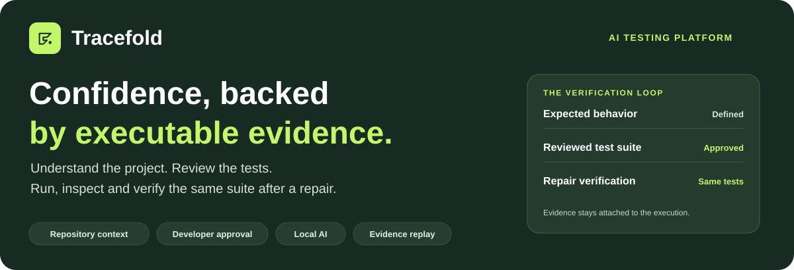
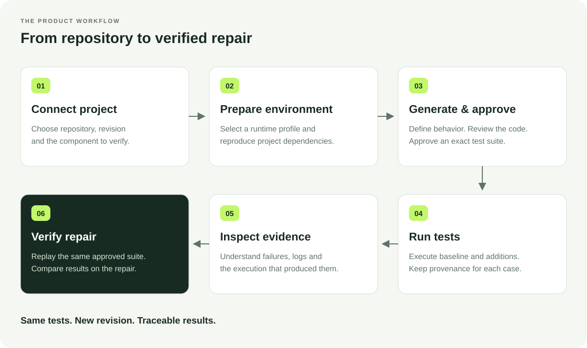
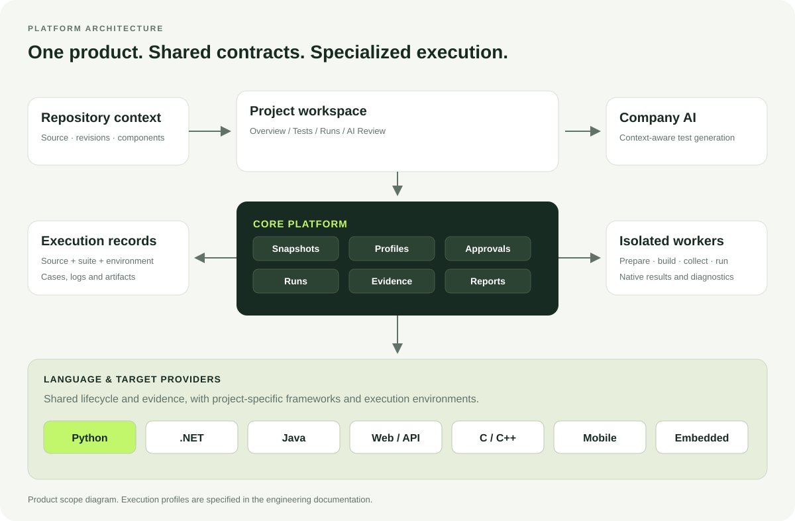

  

  <strong>One testing workspace for Backend, AI, Web, API, Mobile and Embedded engineering.</strong>

  <a href="#the-platform">The platform</a> ·
  <a href="#the-experience">The experience</a> ·
  <a href="#capabilities">Capabilities</a> ·
  <a href="#language-and-target-profiles">Languages &amp; targets</a> ·
  <a href="#technology">Technology</a> ·
  <a href="#platform-design">Platform design</a>

## The platform

Tracefold is an **AI-assisted testing platform** that connects project context, test design, controlled execution and verifiable results. Its product model brings the entire testing journey into a repository-backed workspace: understand the code, define the behavior, review the tests, execute them and retain the evidence.

The platform is organized around **projects and execution profiles**, rather than a collection of language-specific utilities. Shared concepts—snapshots, approvals, suites, runs and evidence—connect specialized language and target providers to the same developer experience.

This overview describes the complete product scope. The implementation boundary is stated in [Product scope and runtime support](#product-scope-and-runtime-support); language logos are not a claim that every provider is executable.

### What the developer gets

| Need | Tracefold's product value |
|---|---|
| Understand what is being tested | A selected component, immutable revision and declared execution profile |
| Create meaningful tests | AI-assisted scenarios grounded in project context and expected behavior |
| Keep control over generated code | Review, editing and explicit approval of an exact suite |
| Determine what actually happened | Native execution outcomes, diagnostics and retained artifacts |
| Verify a repair consistently | The same approved tests executed against the repaired revision |
| Explain a result to another engineer | A report tied to source, test and environment identities |

## The experience

  

The journey begins with the project. A developer selects the revision and component, prepares the appropriate environment and establishes the existing baseline. Expected behavior guides additional tests; human review determines whether the assertions are valid. Execution produces the evidence, and repair verification reuses the approved suite.

Projects without tests enter through test generation after environment preparation. A pull request is not required. Where PR-driven verification is part of a selected workflow, the change identifies the testing scope rather than defining a separate product.

### A result that means something

For a requirement such as “a 20% discount on 10,000 cents returns 8,000 cents,” the evidence should make the comparison explicit:

| Revision | Expected | Observed | Outcome |
|---|---:|---:|---|
| Defective implementation | 8,000 | 12,000 | Failed assertion |
| Repaired implementation, same approved test | 8,000 | 8,000 | Passed assertion |

The test identity stays fixed. Source and environment changes remain visible. A failed assertion requires investigation of both implementation and expectation; a passed suite does not certify behavior it never exercised.

## Capabilities

The full product scope is grouped into connected capabilities, all organized around the same project and its execution history.

### Project intelligence

Repository context connects source revisions, components, modules and relevant test assets. Language/runtime profiles identify how a component is built and tested. A mixed-language repository is a collection of components with explicit execution requirements, not one undifferentiated command.

### AI-assisted test design

Expected behavior, source context, imports, fixtures and existing tests inform generated scenarios. The testing model covers functions, files, modules, repositories and change-focused verification. Boundary cases, exceptions and invalid inputs belong to the behavior definition rather than being guessed from syntax alone.

### Review and approval

Generated code remains visible to the developer. Drafts can be inspected and edited before approval. The approved suite has an independent identity so a subsequent run cannot silently substitute new assertions or regenerate expectations to match a repair.

### Execution environments

An execution profile declares the runtime, dependencies, build/test framework and required target environment. Preparation and execution are distinct operations. Language providers interpret the project-specific details while the shared platform owns lifecycle and result handling.

### Test execution and diagnostics

Existing and generated cases retain provenance. Per-case outcomes distinguish assertion failures, environment/setup problems, skipped cases and incomplete execution. Provider-native case identities and diagnostics accompany normalized results so an engineer can investigate the original failure.

### Evidence and reporting

A report answers: **what ran, against which source, using which tests, in which environment, and with what result?** Cases, logs, native artifacts and checksums connect the readable outcome to its execution. History preserves the context needed to reopen and discuss a result.

### Repair verification

Re-execution keeps the approved suite fixed while the source changes. Before/after comparison identifies changed outcomes and inventory differences. Environment changes are disclosed instead of implying that every observed improvement came exclusively from a code edit.

### AI code review

Change analysis identifies potential defects, their locations, impact and suggested corrections. Advisory findings and executed test evidence remain distinct: a model's explanation is not a substitute for a test result.

### Verification insights

The wider product scope includes measured coverage, missing-case analysis and identification of weak tests. These insights complement execution evidence; they must come from declared measurement or analysis rather than invented quality percentages.

### Engineering workflow integration

The complete product definition includes CI/PR verification, repository-host integration and access-controlled team operation. Permissions, job ownership, retained reports and operational controls connect testing to an engineering organization's workflow. These capabilities share the project model rather than becoming unrelated tools.

## Language and target profiles

  &nbsp;&nbsp;
  &nbsp;&nbsp;
  &nbsp;&nbsp;
  &nbsp;&nbsp;
  &nbsp;&nbsp;
  &nbsp;&nbsp;
  &nbsp;&nbsp;
  &nbsp;&nbsp;
  &nbsp;&nbsp;
  

Language and target profiles define the platform's breadth. Each profile pairs a language with the project's real build system, test framework and execution environment.

| Profile | Engineering context | Execution contract |
|---|---|---|
| **Python** | Backend logic, libraries, AI/data-processing components | Project dependencies, internal imports, fixtures and pytest cases |
| **C# / .NET** | Backend services and shared libraries | SDK/project references, package restore, build and framework-native tests; xUnit is the defined initial profile |
| **Java** | Backend services and multi-module applications | JDK, module/classpath configuration, build and JUnit results; Maven is the defined initial profile |
| **JavaScript / TypeScript** | Web applications, Node.js and shared frontend/backend logic | Project packages, build tooling and declared unit/component/browser test environments |
| **C / C++** | Native libraries and board-independent embedded logic | Compiler, headers, linkage, target flags and native test frameworks such as GoogleTest or Unity/Ceedling |
| **Mobile** | Android/iOS and cross-platform application components | Toolchain, application test harness and declared emulator/device requirements; language alone is insufficient |
| **Embedded** | Firmware, hardware-independent logic and target-specific behavior | Host tests, cross-build, simulation and hardware execution are separate profiles with explicit target evidence |
| **API services** | Service behavior and integration boundaries | API contracts, fixtures, declared dependencies/services and controlled test environments |
| **AI systems** | Deterministic data/inference wrappers and model-dependent behavior | Separate profiles for deterministic code tests, datasets, model evaluation and accelerator requirements |

Web, API, Mobile and Embedded are **execution domains**, not additional programming languages. Likewise, reading a file does not establish build or runtime support. Host, simulator and physical-device outcomes retain their target identities and cannot substitute for one another.

## Technology

These are the technologies used to build the application and its implemented execution foundation, separate from the product's language profiles above.

| Layer | Technologies |
|---|---|
| **Web workspace** |  React 19 &nbsp;  TypeScript 5.8 &nbsp;  Vite 6 |
| **Application services** |  Python / FastAPI / Pydantic / Uvicorn &nbsp;  |
| **Application tooling** |  Node.js / npm |
| **Persistence** |  SQLite / SQLAlchemy &nbsp;  PostgreSQL configuration |
| **Execution isolation** |  Docker, prepared project environments and pinned test harnesses |
| **Local AI** | Company-hosted Ollama and `gemma4:e4b` |
| **Source context** | Public GitHub API, immutable revisions and verified archives |

## Platform design

  

### Shared Core

Projects, source snapshots, profiles, approvals, suites, runs, reports and evidence form the shared vocabulary. The core coordinates lifecycle, persistence, reconciliation and comparison without embedding a specific test framework into those concepts.

### Specialized providers

Providers translate a project's language, build system and target requirements into discovery, preparation, collection and execution. They preserve native test identities and artifacts while returning results through common contracts. A new language is a validated execution profile, not a renamed file picker.

### Company-controlled AI

The model service supplies test drafts and advisory analysis. Expected behavior and human approval remain explicit. Existing-test execution is independent of generation. Local model hosting describes the AI boundary; repository and package acquisition have their own network requirements.

### Traceable execution

An execution connects an immutable source snapshot, an approved suite, an environment and native results. Independent identities allow the platform to answer whether the code, tests or environment changed between two outcomes.

## Product scope and runtime support

This README is the **complete platform overview**, not a declaration that every described provider and organizational capability is shipped.

The executable foundation in this repository is **public GitHub + Python 3.11/Linux/pip/pytest**, including repository environments, existing-test execution, bounded repository-context generation, review/approval, saved evidence and same-suite repair replay. Advisory PR review and earlier focused file/function tools are also implemented.

Other language/target profiles, measured coverage, CI/PR execution automation and shared team controls describe the full product scope. They are not enabled by the Python provider or by displaying their logos. Runtime acceptance must be established for each profile.

Technology logos belong to their respective owners. Vendored Devicon artwork and license: <a href="docs/assets/README.md">asset credits</a>.
