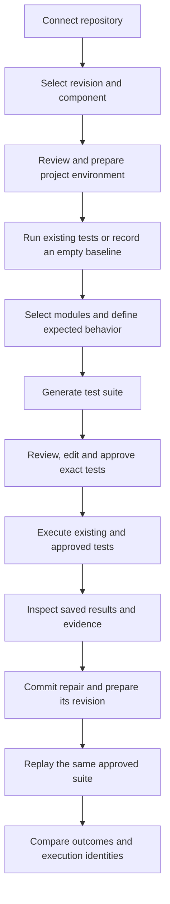
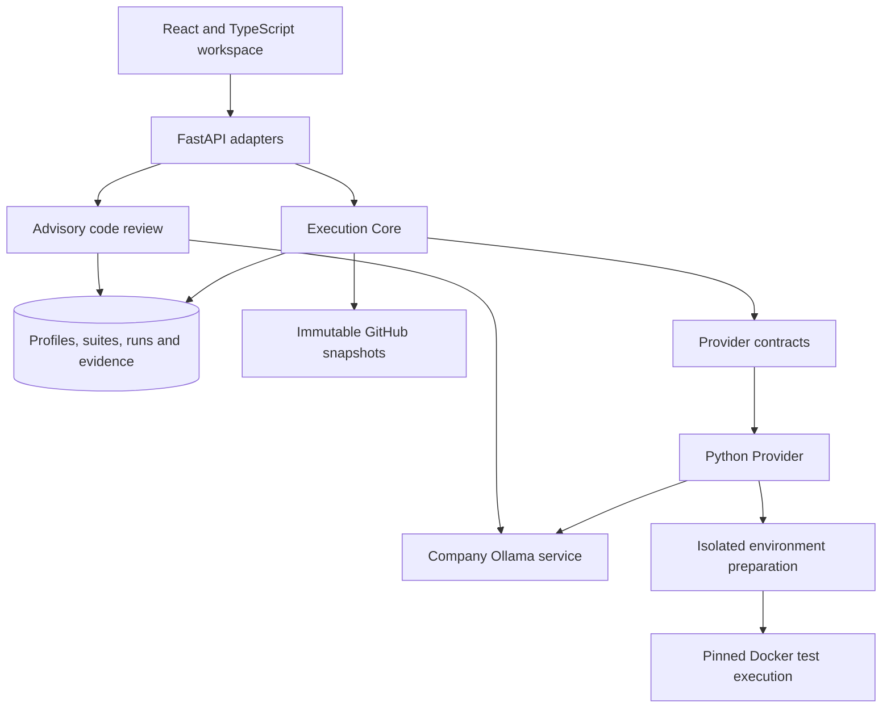

# Tracefold

### Turn expected behavior into executable evidence.

Tracefold is an AI-assisted testing platform for repository-based development. It brings project environments, test generation, developer approval, execution and repair verification into one workspace.

Connect a repository, describe what the code should do, review the proposed tests and run them against the actual project. Keep the results, fix the code and run the same tests again.

[Getting started](#getting-started) · [Features](#features) · [Workflow](#workflow) · [Architecture](#architecture) · [Configuration](#configuration)

## Features

### Repository workspaces

Organize testing around a project. Connect a public GitHub repository, choose a branch, tag or commit, and select the component to test. Tracefold records the resolved revision and verifies its source snapshot so every execution has a traceable input.

### Project-aware test generation

Generate pytest suites using selected source modules, related internal imports, relevant fixtures, existing test examples and the prepared environment's package information. Describe expected outputs, boundary conditions and exceptions to guide the assertions.

Generation runs through the company-hosted Ollama service. Source context is sent to that configured model endpoint rather than a third-party model API.

### Developer-controlled approval

Inspect the generated scenarios and source code before execution. Edit the draft, save the changes and approve the exact suite definition. Approval binds to its hash; approved test code is locked against further editing.

### Isolated project execution

Prepare project dependencies and install the actual package inside Docker, independently of Tracefold's application environment. Execute the repository's existing tests and approved generated additions with native test identities, project imports, fixtures and configuration.

### Results for every test

Inspect passed and failed cases, collection errors, fixture failures, skipped cases and execution diagnostics. Existing and generated cases retain separate provenance. Missing or inconsistent evidence cannot produce a clean pass.

### Repeatable repair verification

Select a repaired revision, prepare its environment and replay the same approved suite without regenerating it. Compare outcomes while retaining the source revision, suite hash, environment identity and case inventory for both executions.

### Persistent execution evidence

Reopen saved suites and reports from the project history. Each run retains its configuration, normalized results, native evidence, logs and artifact checksums. Results survive page refresh and application restart when the same data store is used.

### AI pull request review

Import a public pull request and request an advisory review of its saved diff. Findings identify the location, impact and suggested correction. Code review is a separate analysis action; test execution provides its own evidence.

## Workflow



A pull request is not required. A project without existing tests can begin with generation after environment preparation. An empty baseline is recorded explicitly; collection failures are reported as errors rather than interpreted as an absence of tests.

### Example: verify a discount calculation

The developer defines the requirement: a 20% discount on 10,000 cents must return 8,000 cents. A test calls the real project function and checks that result.

| Execution | Expected | Actual | Result |
|---|---:|---:|---|
| Defective calculation | 8,000 | 12,000 | Failed |
| Repaired calculation, same assertion | 8,000 | 8,000 | Passed |

The value is the executable assertion and retained before/after evidence. A failed test still requires investigation: either the implementation or the expectation may be wrong. Passing cases do not prove correctness of untested behavior.

## Project workspace

| View | Purpose |
|---|---|
| **Overview** | Project context, saved activity and entry into testing |
| **Tests — Existing tests** | Revision selection, environment configuration and repository execution |
| **Tests — Generated tests** | Source selection, expected behavior, saved drafts and approved suites |
| **Runs** | Execution history, per-case results and evidence |
| **AI Review** | Pull request selection and saved advisory findings |

Direct links open a saved execution or suite. Earlier focused file/function sessions remain accessible with their original reports.

## Architecture



Core owns profile lifecycle, approval identities, persistence, evidence reconciliation and comparison. The provider owns runtime discovery, dependency preparation, framework-specific generation and native execution. The composition root connects these boundaries.

Python project execution uses Linux containers and pytest. The frontend and API run as application processes on the host. Docker isolates project preparation and execution; it is independent of the choice of database. `compose.yaml` provides a PostgreSQL service, not an application deployment.

### Execution model

1. Resolve and verify an immutable repository snapshot.
2. Validate and approve the selected provider configuration.
3. Download supported wheels in a source-free container, then install the project offline in isolation.
4. Pin the prepared image and execution harness.
5. Collect and execute tests in temporary source copies with no runtime network access.
6. Reconcile native cases with recorded outcomes and persist the report.

Existing and generated suites run in separate fresh-copy phases within the same prepared environment. Approved additions do not overwrite repository files or commit changes. A repair uses its own prepared environment, and comparisons disclose environment changes alongside source changes.

## Technology

| Layer | Technology |
|---|---|
| Frontend | React 19, TypeScript 5.8, Vite 6, CSS |
| API | FastAPI, Pydantic, Uvicorn |
| Persistence | SQLAlchemy, SQLite; PostgreSQL configuration |
| Repository source | Public GitHub REST API and verified archives |
| AI | Ollama, `gemma4:e4b` |
| Project execution | Python 3.11, Linux, pip, pytest |
| Isolation | Docker bootstrap and prepared project images |
| Verification | Python unittest, native container integration checks, TypeScript and production build |

The application host uses Python 3.13 and Node.js 22 in the validated Windows setup. The tested project's interpreter is separate from the application's interpreter.

## Getting started

### Requirements

- Git, Node.js 22 with npm, and Python 3.13.
- Docker Desktop with Linux containers enabled.
- Access to GitHub and the package registry for source and dependency acquisition.
- Access to the configured company Ollama service for AI generation and review. Running existing tests does not require a model connection.

### Install

Windows PowerShell:

```powershell
git clone https://github.com/ziademad02153/tracefold.git E:\Tracefold
Set-Location E:\Tracefold

python -m venv .venv
.venv\Scripts\python.exe -m pip install -r requirements.txt
npm.cmd ci
docker build -t tracefold-pytest:1 runner
```

### Start

```powershell
npm start
```

The launcher starts the API and frontend, waits for readiness and opens the workspace. Ctrl+C stops processes started by the launcher; existing services remain owned by their original terminals.

| Address | Service |
|---|---|
| [127.0.0.1:5173](http://127.0.0.1:5173/#projects) | Development workspace |
| [127.0.0.1:8001/docs](http://127.0.0.1:8001/docs) | Interactive API reference |

`npm run dev` starts the frontend only. Use `npm start` to launch both application services.

### Build and serve the compiled interface

```powershell
npm run build
.venv\Scripts\python.exe -m uvicorn app:app --host 127.0.0.1 --port 8001
```

Restart an existing backend after building. FastAPI serves the compiled interface and API together at [127.0.0.1:8001](http://127.0.0.1:8001/).

## Configuration

Set variables in the terminal that launches the backend:

```powershell
$env:OLLAMA_BASE_URL = 'http://10.11.3.181:11434'
$env:TRACEFOLD_TEST_MODEL = 'gemma4:e4b'
npm start
```

| Variable | Purpose | Default |
|---|---|---|
| `OLLAMA_BASE_URL` | Company model service | `http://10.11.3.181:11434` |
| `TRACEFOLD_TEST_MODEL` | Repository test-generation model | `gemma4:e4b` |
| `DATABASE_URL` | SQLAlchemy persistence connection | Local `tracefold.db` |
| `POSTGRES_PASSWORD` | Password required by the optional Compose database | Supplied by the operator |

The app reads process environment variables, not an automatically loaded `.env` file. The earlier file tool and PR reviewer use their fixed `gemma4:e4b` model constant. Changing the database URL selects another store; it does not migrate reports. PostgreSQL integration and data migration require separate deployment validation.

## Execution profile

| Dimension | Support |
|---|---|
| Repository | Public GitHub |
| Runtime | Python 3.11 on Linux |
| Project structure | Supported installable components, including internal imports and multiple modules |
| Dependencies | Explicit pip inputs, registry wheels and offline project installation |
| Test framework | pytest with project configuration, conftest, fixtures, parameterized cases and selected plugins |
| Generation | Up to three selected modules and 3–8 test functions in one reserved file per batch |
| Context | Bounded source modules, one-hop imports and relevant bounded fixtures/examples |
| Evidence | Native identities, normalized outcomes, logs and checksummed text artifacts |

Private repositories, automatic uv/Poetry workspace resolution, external service orchestration, GPU evaluation, non-Python runtimes and device execution are outside this execution profile.

The default repository worker policy bounds preparation to 360 seconds and execution to 120 seconds, with 1 GB memory, 2 CPUs, 128 PIDs and 256 MB temporary space. Source limits include 16 MB compressed, 64 MB expanded and 5,000 files; case reconciliation permits up to 5,000 collected tests. These are resource policies, not performance guarantees.

## Verification

With Docker running and the bootstrap image built:

```powershell
.venv\Scripts\python.exe -m unittest test_ai_review test_workbench test_docker_runner test_execution_core test_repository_suites test_repository_runner test_repository_suite_runner -q
npm run build
```

Container integration checks require registry access during preparation. Saved acceptance records under [evidence/](evidence/) include upstream execution, defect/repair replay, browser behavior and persistence checks. Automated regression execution is separate from evaluating model quality.

## Source layout

```text
src/                    React workspace, navigation and execution views
src/providers/          Provider-specific configuration forms
execution_core/         Contracts, approval, lifecycle, persistence and comparison
execution_api.py        Generic execution and suite HTTP adapter
providers/              Python discovery, generation, preparation and execution
snapshot_store.py       Verified immutable source acquisition and cache
app.py                  Composition root, projects and PR reports
ai_review.py            Advisory diff-review generation and validation
workbench.py            Focused file/function compatibility workflow
test_runner.py          Focused execution compatibility runner
runner/                 Bootstrap Docker image
scripts/start.mjs       Combined application launcher
test_*.py               Core, persistence, AI and execution regressions
evidence/               Portable verification records
compose.yaml            Optional PostgreSQL service
```

## Data and runtime boundaries

Source control contains application code and portable verification records. The local database, cached snapshots, dependencies, compiled frontend and prepared Docker images are separate runtime artifacts. Cloning the repository does not restore saved local reports.

Repository installation and generated tests execute as untrusted workloads. Runtime isolation uses no-network execution, non-root identity, read-only inputs/root, dropped capabilities and resource bounds. Jobs receive neither application credentials nor the host Docker socket.

The documented launch binds to localhost for supervised use. Shared deployment requires an access-controlled operational boundary, including authentication, authorization, durable job handling, resource quotas, backups and recovery.
