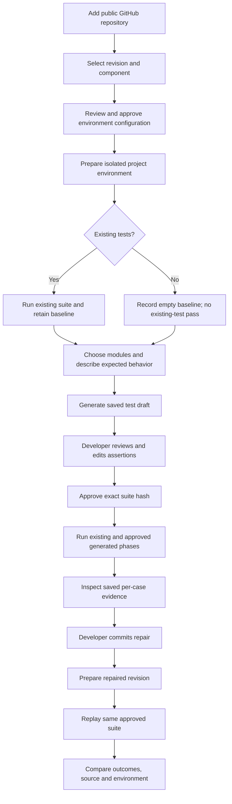
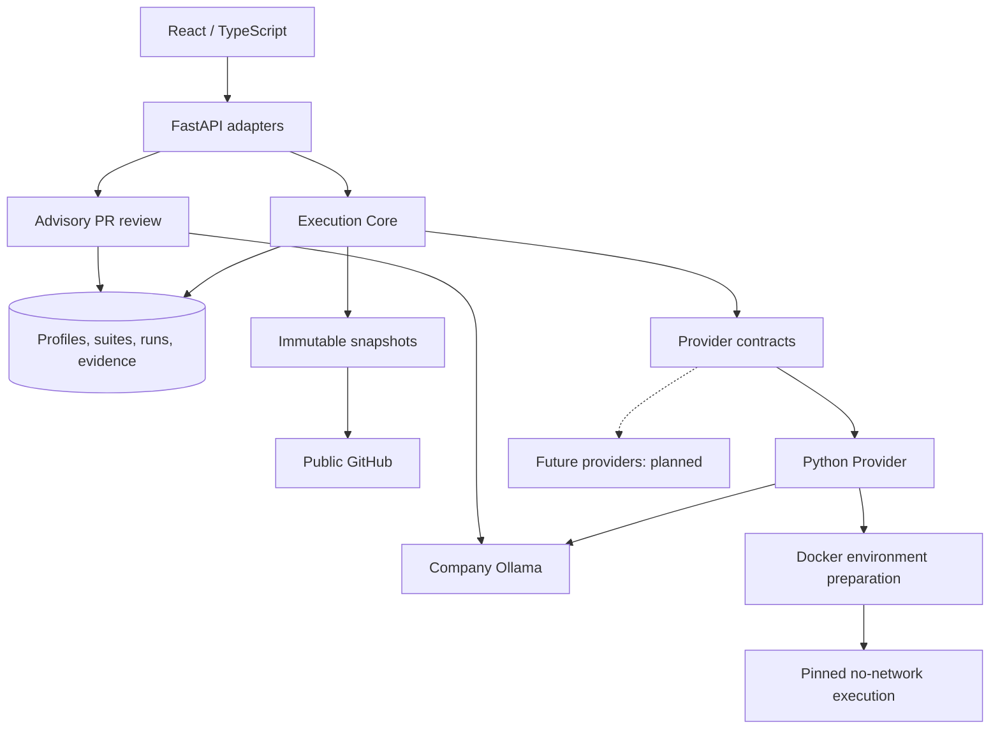
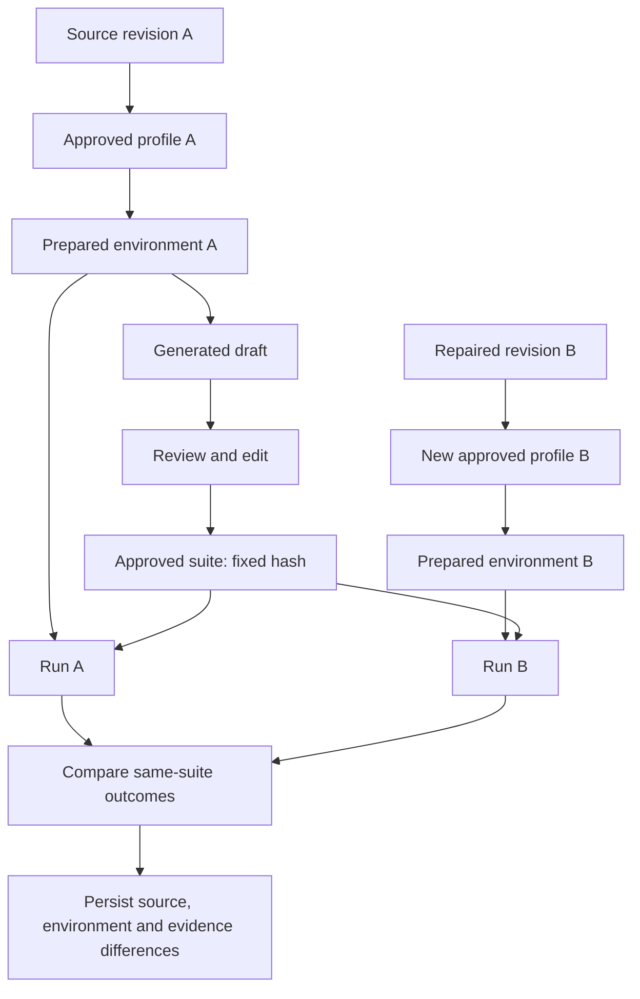
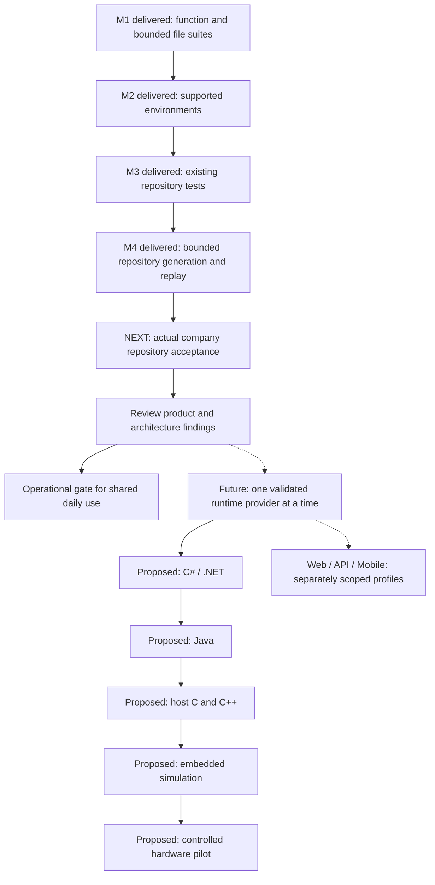

# Tracefold

**AI-assisted repository testing, with reviewed tests and saved execution evidence.**

Connect a repository, prepare its supported environment, run existing tests, generate additional tests with the company's local model, and replay the same approved suite after a repair.

**Status: supervised, single-user local pilot.** Python is the first implemented runtime provider. Core Platform manages projects, snapshots, profiles, approved suites, runs and evidence. Other languages and shared team deployment remain future work.

> **ببساطة:** تربط مشروعك، تشغّل اختباراته، وتطلب اختبارات إضافية من الـAI. تراجعها وتعتمدها، ثم تشوف دليل النجاح أو الفشل وتعيد نفس الاختبارات بعد إصلاح الكود. الدعم الحالي لمشاريع Python ضمن الحدود الموثقة؛ باقي اللغات وخدمة التيمات مراحل لاحقة.

Updated **4 November 2026**. Status labels describe observed implementation, not maturity percentages or promised dates.

## Contents

- [Product value](#product-value)
- [Feature map](#feature-map)
- [User journey](#user-journey)
- [Project navigation](#project-navigation)
- [Architecture](#architecture)
- [Data and execution lifecycle](#data-and-execution-lifecycle)
- [Technology stack](#technology-stack)
- [Quick start](#quick-start)
- [Configuration](#configuration)
- [Troubleshooting](#troubleshooting)
- [Supported scope and limits](#supported-scope-and-limits)
- [Verification](#verification)
- [Roadmap](#roadmap)
- [Repository map](#repository-map)
- [API map](#api-map)
- [Engineering and deployment](#engineering-and-deployment)
- [Documentation index](#documentation-index)

## Product value

| Developer need | Current value |
|---|---|
| Run project tests without installing project packages into Tracefold | Explicitly configured, isolated environment |
| Start testing code with few or no tests | AI-generated drafts based on selected modules and developer-defined expected behavior |
| Find out whether a test reveals a defect | Native execution and failure details, rather than an AI claim alone |
| Check a repair without changing the tests | Replay the exact approved suite with its hash unchanged |
| Understand what ran later | Saved per-case evidence, immutable source and environment identities |
| Review a pull request | Separate advisory diff analysis, distinguished from executed tests |

A failed assertion may indicate a production defect **or an incorrect test expectation**. The developer reviews the oracle. Passing tests do not certify the whole repository; no coverage measurement is currently provided.

## Feature map

**Implemented** means delivered on the documented local profile. **Pending validation** means acceptance is not demonstrated. **Planned** does not imply a working capability.

| Area | Capability | Status and boundary |
|---|---|---|
| Projects | Connect public GitHub repository and open workspace | Implemented; no private connector |
| Snapshots | Verified source at branch/tag/commit | Implemented; resolved commit and content hash retained |
| Environments | Component root, install inputs, plugins and test arguments | Implemented for Python 3.11/Linux/pip/pytest |
| Isolation | Separate virtual environment and actual project installation inside Docker | Implemented; explicit supported registry wheels |
| Existing tests | Collect and run configured repository tests | Implemented; imports, fixtures, configuration and native IDs retained |
| M4 generation | Additional tests inside prepared project context | Implemented: up to 3 modules, 3–8 test functions, one file per batch |
| Review/approval | Read/edit/save draft and approve exact definition | Implemented; edits change hash; approved code is locked |
| Combined verification | Existing and approved generated tests | Implemented as separate fresh-copy phases in the same pinned environment |
| Evidence | Per-case outcomes, diagnostics, logs and checksums | Implemented; bounded inline text artifacts |
| Repair replay | New revision/environment with unchanged approved suite | Implemented; source/environment/case differences recorded |
| Persistence | Reopen saved suites/reports after refresh/restart | Verified locally with SQLite |
| AI Review | Public PR import and saved advisory findings | Implemented; no test execution or posted GitHub comments |
| Earlier file/function tools | Focused Python suites and historical reports | Retained separately for compatibility |
| Company acceptance | Validate on actual company project | Pending; repo/reference commands not supplied |
| Shared team service | Accounts, access controls, durable jobs and hosting | Not implemented; operational release gate open |
| Other runtimes | .NET, Java, JavaScript/Web, Mobile, C/C++/Embedded | Planned; no second runtime provider delivered |
| Later extensions | Coverage, CI/PR automation, notifications/integrations | Future scope; no automatic fix/merge decision |

## User journey



No PR is required for testing. Without existing tests, generation can begin after preparation. Import/collection errors are not a valid empty baseline. AI proposes code; pytest executes it. Invalid generation is rejected, not shown as successful verification.

## Project navigation

| Destination | Purpose | Route |
|---|---|---|
| Projects | Connect/open project | `#projects`, `#connect` |
| Overview | Context and saved activity | `#project/{encoded-repository}` |
| Tests → Existing tests | Environment setup and existing suite | `#tests/{encoded-repository}` |
| Tests → Generated tests | Generate/review/reopen suites | `#generated/{encoded-repository}` |
| Runs | Saved execution reports | `#runs/{encoded-repository}` |
| AI Review | PR selection and advisory analysis | `#ai-review/{encoded-repository}` |
| Execution report | Profile, results and evidence | `#execution/{profile-id}` |
| Exact suite | Direct saved-suite view | `#execution/{profile-id}/generate/{suite-id}` |

Reports/evidence belong inside the project journey. Earlier file-tool/report URLs and aliases remain usable.

## Architecture



The composition root registers Python. The new execution core/HTTP adapter does not import Python discovery or pytest execution code. Options/environment identities are provider-owned; lifecycle/persistence are shared. A non-Python-shaped contract fixture checks the boundary but is not another delivered runtime. Future providers may need versioned contract extensions. See [M4 architecture self-review](ARCHITECTURE_REVIEW_M4.md).

**Docker** isolates project preparation/execution. React/FastAPI run on the host. `compose.yaml` starts optional PostgreSQL only, not the app/model. Docker and a database serve different purposes. Supabase is not used.

Preparation separates source-free networked wheel download from offline project installation. Execution returns native cases/checksummed artifacts through the provider to Core for reconciliation and persistence; workers do not access the application database.

**AI** generates tests and advisory findings through company-hosted Ollama. Existing-test execution requires no model. GitHub and package preparation need their own network access; local AI does not make the entire platform offline.

## Data and execution lifecycle

| Object | Identity and purpose |
|---|---|
| Project | Repository-backed workspace and activity |
| Snapshot | Repository + immutable commit + verified source hash |
| Execution profile | Snapshot + provider/version + validated configuration + policy; independently approved |
| Prepared environment | Opaque image identity with runtime/dependency/executor manifest |
| Generated suite | Origin, expected behavior/context, exact files and independent approval hash |
| Run | Saved execution against one source/profile/environment, optionally an approved suite |
| Evidence/report | Cases, normalized outcomes, diagnostics, checksums and readable result |



Replay does not regenerate tests. A repair needs its own environment, which may have a different image. Comparison discloses that difference instead of attributing every changed outcome solely to source. Earlier runs keep original manifests if an environment is rebuilt.

Reconciliation prevents absent, duplicate, unknown or incomplete results becoming clean passes. Passed/failed/error/skipped/expected-failure/unexpected-pass/not-run outcomes remain distinguishable.

## Technology stack

| Layer | Implementation |
|---|---|
| Frontend | React 19, TypeScript 5.8, Vite 6; CSS and hash navigation |
| Backend | FastAPI, Pydantic validation, Uvicorn |
| Application runtime | Windows setup validated with Python 3.13 and Node.js 22 |
| Persistence | SQLAlchemy, SQLite default, optional PostgreSQL 16 Compose configuration |
| Source acquisition | Public GitHub REST API and verified archives |
| AI | Company Ollama; `gemma4:e4b` |
| Execution provider | Python 3.11/Linux/pip/pytest; project dependencies recorded |
| Isolation | Docker bootstrap image, prepared images, bounded execution containers |
| Checks | Python unittest, real Docker regressions, TypeScript/build, separately recorded browser acceptance |

Host Python and project Python are separate responsibilities. Frontend dependencies are locked in `package-lock.json`; backend ranges are in `requirements.txt`. The approved project environment determines its pytest version, not necessarily the bootstrap default.

## Quick start

### Prerequisites

- Node.js 22/npm and Python 3.13 for the validated local setup.
- Git and Docker Desktop running with Linux containers.
- GitHub/package-registry access for source/dependencies.
- Company Ollama access for generation/review; existing tests need no AI connection.

### First setup — Windows PowerShell

Clone into the intended workspace, for example `E:\Tracefold`, then:

```powershell
Set-Location E:\Tracefold
python -m venv .venv
.venv\Scripts\python.exe -m pip install -r requirements.txt
npm.cmd ci
docker build -t tracefold-pytest:1 runner
```

Set required configuration in that terminal, then launch:

```powershell
npm start
```

This starts FastAPI/Vite, waits for readiness and opens the browser. Later launches use the same command. Ctrl+C stops services started by the launcher; existing services remain owned by their original terminals. Conflicting services on its ports produce an error.

| Address | Purpose |
|---|---|
| [127.0.0.1:5173](http://127.0.0.1:5173/#projects) | Development UI; proxies `/api` to backend |
| [127.0.0.1:8001/docs](http://127.0.0.1:8001/docs) | OpenAPI interface |
| [127.0.0.1:8001](http://127.0.0.1:8001/) | Compiled UI/API after build and backend restart |

`npm run dev` starts **only the frontend**. Use `npm start` for combined startup.

### Compiled frontend and manual backend

```powershell
npm run build
.venv\Scripts\python.exe -m uvicorn app:app --host 127.0.0.1 --port 8001
```

Restart an existing backend after building. Compiled local mode is not completed production deployment.

### Validated repository example

Add `pallets/itsdangerous`, tag `2.2.0`, root `.`, enable project installation, select `requirements/tests.txt` and `requirements/build.txt`, remove the extra default pytest pin, retain `-q`, save/approve/prepare and run. Project requirements supply pytest. See [M2/M3 profile](M2_M3.md).

Saved reports require the original local database/images. A fresh clone does not recreate previous runs automatically.

## Configuration

| Variable | Scope | Behavior |
|---|---|---|
| `OLLAMA_BASE_URL` | Backend AI requests | Defaults to `http://10.11.3.181:11434`; requires company-network access or approved routing |
| `TRACEFOLD_TEST_MODEL` | M4 generation | Defaults to `gemma4:e4b`; earlier file/PR tools use their own fixed `gemma4:e4b` constant |
| `DATABASE_URL` | Backend persistence | Defaults to local `tracefold.db`; can select PostgreSQL via SQLAlchemy URL |
| `POSTGRES_PASSWORD` | Optional Compose database | Required when starting its PostgreSQL service |

Example using the default SQLite store:

```powershell
$env:OLLAMA_BASE_URL = 'http://10.11.3.181:11434'
$env:TRACEFOLD_TEST_MODEL = 'gemma4:e4b'
npm start
```

The app reads process environment variables; it does not load `.env` automatically. Never commit credentials. PostgreSQL/SQLite are separate stores: changing the URL does not migrate reports. PostgreSQL integration/migrations/backups remain pending. No authenticated/private GitHub connector is implemented.

## Troubleshooting

| Symptom | Check / next action |
|---|---|
| UI opens but API requests fail | Use `npm start`; `npm run dev` launches no backend. Inspect the API terminal and port 8001. |
| Docker runner is unavailable | Start Docker Desktop/Linux containers and build `tracefold-pytest:1` with the setup command. |
| AI request cannot connect | Check company-network access and `OLLAMA_BASE_URL` in the backend process. Existing tests remain independent of AI. |
| Repository has no PRs | Open Tests. Repository testing does not require a PR. |
| No existing tests collected | Inspect native collection/configuration. If genuinely empty, prepare the environment and generate reviewed tests; do not call the empty baseline a pass. |
| Environment preparation fails | Read its saved log; check requirements/runtime/component support. Do not remove dependencies merely to force a green result. |
| Old environment cannot run generated suites | Explicitly rebuild its approved environment to install the pinned suite runner; earlier reports retain original manifests. |
| Old reports are missing after clone/database change | Source control does not contain the local database. Restore the intended store or create new runs; changing `DATABASE_URL` is not migration. |

## Supported scope and limits

| Dimension | Current boundary |
|---|---|
| Source | Public GitHub; no private App/Azure DevOps/GitLab connector |
| Runtime | Python 3.11/Linux; no automatic substitution |
| Dependencies | Explicit pip inputs, public wheels and offline project install; no automatic uv/Poetry lock adapter/private registry |
| Internal imports | Retained in the actual supported project environment |
| Multi-module | Multiple modules in one component; separately packaged workspace dependency ordering not implemented |
| Pytest | Project configuration/resources/conftest/fixtures, parameterized IDs, selected plugins |
| Context | Bounded selected modules, one-hop imports and examples/fixtures; not a full dependency graph |
| Generation | Up to 3 modules, 3–8 distinct test functions, one reserved file, up to 2 structural attempts |
| Overlay | Temporary copies only; no production overwrite/commit/auto-fix |
| Execution | Separate existing/generated phases; effective arguments/provenance saved |
| Other targets | Services, GPU/model evaluation, dependency source builds, mobile and embedded are unsupported profiles |
| Initial source/case bounds | 16 MB compressed / 64 MB expanded, 5,000 source files, 8 MB/file, 5,000 collected cases |
| Worker bounds | 1 GB RAM, 2 CPUs, 128 PIDs, 256 MB temporary space; preparation 360 seconds / repository execution 120 seconds |
| Artifacts | Bounded inline text; no general large/binary store |

These are initial bounds, not capacity/performance guarantees. Large contexts, unsupported layouts/APIs or missing fixtures may need a narrower request or return a blocked result. Reading a language does not establish executable project support.

## Verification

Recorded **4 November 2026**:

| Check | Observed result | Evidence |
|---|---|---|
| Existing upstream suite | itsdangerous 2.2.0: 297 passed and matched direct native pytest reference | [M3 validation](M3_VALIDATION_REPORT.md), [reference](evidence/m2-m3-reference.json) |
| Upstream generated additions | 297 existing + 3 generated: all 300 passed | [M4 capsule](evidence/m4-validation.json) |
| Known-defect installed package | Two modules, internal import/external dependency; 7 cases: 4 passed / 3 failed | [M4 record](M4.md) |
| Same suite after repair | Same hash, all 7 passed; three failures became passes; no case additions/removals | [M4 capsule](evidence/m4-validation.json) |
| Human review | Corrected misleading generated arithmetic comment before approval | [M4 findings](M4.md) |
| Negative paths | Invalid generation, collection/missing-fixture errors, limits and incomplete evidence do not become clean passes | Runner/core checks and milestone records |
| Persistence | Refresh/restart retained suites/results; artifact checksums verified | [M4 capsule](evidence/m4-validation.json) |
| Browser | Generation/review/approval/execution/replay/direct links; no page errors/overflow at tested 390/768/1440 widths | [M4 capsule](evidence/m4-validation.json) |
| Regression/build | 51 tests and frontend build passed; existing non-failing SQLite cleanup warning remains | [Repeatable checks](M4.md) |
| Company project | **NOT RUN**; repository/reference commands pending | [Acceptance record](M3_VALIDATION_REPORT.md) |

The seeded repository is educational, not a company project. These results are not an AI accuracy benchmark, coverage score or universal Python support claim.

With Docker running and the bootstrap image built:

```powershell
.venv\Scripts\python.exe -m unittest test_ai_review test_workbench test_docker_runner test_execution_core test_repository_suites test_repository_runner test_repository_suite_runner -q
npm run build
```

Container checks need registry access during preparation. Real model/browser observations are separate acceptance checks; this command does not benchmark Gemma or repeat the interactive browser journey. Test totals describe the recorded revision.

## Roadmap



| Stage | Remaining work | Exit evidence |
|---|---|---|
| **Next: company pilot** | Actual repo/revision/component/reference commands and unsupported-needs assessment | Baseline parity, reviewed generation, known defects/clean controls, unchanged-suite repair replay, reopened evidence |
| **Acceptance review** | Review real behavior and core/provider findings | Agreed support profile, blockers and next scope decision |
| **Shared-service gate** | Private access/authorization, queued/cancellable jobs, aggregate quotas/preparation disk limits, migrations/backups, retention, cleanup, monitoring | Multi-user isolation/recovery/deployment checks; not delivered by local pilot |
| **Proposed languages** | C#/.NET → Java → host C/C++ → simulator → embedded hardware | Each profile reproduces real baseline and reviewed tests fail before/pass unchanged after repair |
| **Other target profiles** | JavaScript/Web, API integration, Mobile; GPU/dataset/model evaluation | Separate runtime/service/device pilots; no committed dates or sequence |
| **Later extensions** | Measured coverage, CI/PR automation, optional notifications/integrations | Requirements, explicit scope decision and acceptance after core gates |

The next task is company validation. Shared deployment and language expansion both need explicit scope decisions. Language order may change with real demand. No completion percentages or dates are invented.

Details: [Repository Testing Roadmap](REPOSITORY_TESTING_ROADMAP.md), [Language Expansion Roadmap](LANGUAGE_EXPANSION_ROADMAP.md).

## Repository map

```text
Tracefold/
├── src/
│   ├── main.tsx                      Shell, routes and provider views
│   ├── ProjectHome.tsx               Project context/navigation
│   ├── ProjectGeneratedTests.tsx     Repository suite entry
│   ├── RepositoryExecution.tsx       Environment setup/reports
│   ├── RepositorySuiteFlow.tsx       Generate, review, approve, replay
│   ├── ProjectRuns.tsx               Saved execution history
│   ├── executionTypes.ts             Shared UI contracts
│   ├── providers/                    Python-specific forms
│   └── Workbench.tsx                 Earlier file/function tool
├── app.py                           Composition, projects, PR reports
├── execution_api.py                 Generic execution/suite HTTP adapter
├── execution_core/
│   ├── contracts.py                 Contracts, policy, reconciliation
│   └── service.py                   Profiles, approvals, persistence, comparison
├── providers/
│   ├── python_repository.py         First repository provider
│   ├── python_generation.py         Module context/local AI generation
│   ├── container_prepare.py         Isolated environment construction
│   ├── repository_executor.py       Pinned native pytest evidence
│   └── docker_worker.py             Bounded Docker transport/cleanup
├── snapshot_store.py                Verified source acquisition/cache
├── ai_review.py                     Advisory diff review
├── workbench.py / test_runner.py     Earlier compatibility path
├── runner/Dockerfile                Bootstrap execution image
├── scripts/start.mjs                Combined launcher/browser opening
├── test_*.py                        Core/AI/persistence/container checks
├── evidence/                        Portable validation records
├── compose.yaml                     Optional PostgreSQL only
├── package.json / package-lock.json  Frontend dependencies/commands
├── requirements.txt                 Backend ranges
└── *.md                             Product/architecture/milestone docs
```

Ignored local artifacts include `.venv/`, `node_modules/`, `dist/`, `tracefold.db` and `.tracefold/`. Prepared environments are Docker images. GitHub contains source/portable capsules, **not** the database, snapshots or images. Cloning requires setup/preparation; it does not restore local reports.

## API map

The live [OpenAPI schema](http://127.0.0.1:8001/docs) is the endpoint-level reference.

| Prefix | Responsibility |
|---|---|
| `/api/projects` | List/connect public projects |
| `/api/pulls`, `/api/reports` | PR selection, saved diffs, advisory review |
| `/api/executions/providers` | Installed provider capabilities |
| `/api/executions/discover` | Inspect snapshot/component |
| `/api/executions/profiles` | Profiles, preparation, saved runs |
| `/api/executions/profiles/{id}/generation-context` | Source catalog/limits |
| `/api/executions/profiles/{id}/suites` | Generate repository draft |
| `/api/executions/suites` | List/read/revise/approve suites |
| `/api/executions/profiles/{id}/revision` | New source profile for replay |
| `/api/executions/activity` | Recorded suite/profile/run activity |
| `/api/testing` | Earlier focused file/function sessions |

Approvals use explicit hashes; blocked execution is not a passed test. There is no application-user authorization layer yet. The API belongs inside the local pilot boundary.

## Engineering and deployment

- Keep generic lifecycle/identity/evidence in `execution_core/`; language/framework/build logic belongs in providers and provider-specific UI.
- Evolve contracts deliberately. Preserve approved suites/manifests; never silently regenerate during replay.
- Run relevant checks/build and update evidence when behavior changes. Do not fabricate green CI badges or coverage values.
- Repository installation/generated tests are executable, untrusted workloads. Runtime containment includes no network, non-root/read-only execution, dropped capabilities and resource bounds; shared-service security acceptance remains open.
- Package downloads receive no source/credentials; installation runs offline in isolation. Jobs receive neither the host Docker socket nor application credentials.
- Managed migrations/backups/retention/recovery and image/cache cleanup remain release work.
- Changing the bind address alone does not produce a team service. Internal hosting/domain/TLS and user access require the operational gate.

## Documentation index

| Document | Role |
|---|---|
| [README](README.md) | Main feature/status/setup/project map |
| [Product](PRODUCT.md) | Definition and current scope pointers |
| [Blueprint](PRODUCT_BLUEPRINT.md) | Current navigation; labeled historical baselines |
| [Repository roadmap](REPOSITORY_TESTING_ROADMAP.md) | M1–M4 and acceptance/operational gates |
| [M4](M4.md) | Current generation/approval/execution/replay and evidence |
| [M4 architecture review](ARCHITECTURE_REVIEW_M4.md) | Current boundaries/open findings |
| [M2/M3](M2_M3.md) | Environment/existing-test profile/reference |
| [M3 validation](M3_VALIDATION_REPORT.md) | Existing-test evidence/pending company acceptance |
| [Language expansion](LANGUAGE_EXPANSION_ROADMAP.md) | Future .NET/Java/C/C++/Embedded |
| [M3 architecture review](ARCHITECTURE_REVIEW_M3.md) | Historical boundary extended by M4 |
| [Sprint 1](SPRINT1.md), [Sprint 2](SPRINT2.md), [Sprint 3](SPRINT3.md) | Historical function/file records |
| [Engineering roadmap](ROADMAP.md) | Current pointer followed by historical audit |
| [Audit](AUDIT.md), [validation](VALIDATION.md) | Earlier review-stage records, not current whole-platform acceptance |
| [Evidence](evidence/) | Portable capsules; native artifact bodies remain local |
